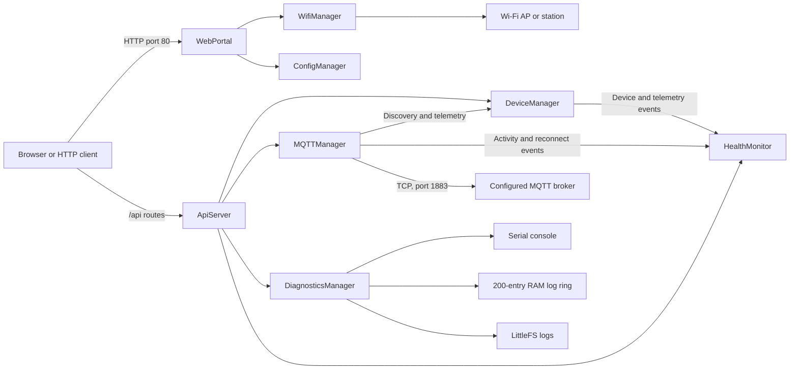

# Ampercore Hub

ESP32 firmware for a local IoT hub that provides Wi-Fi setup, a small web portal, a REST API, MQTT device discovery and telemetry, and runtime diagnostics and health reporting.

## Project Overview

The firmware runs on an ESP32 development board and exposes an HTTP service on port 80. It can start as a Wi-Fi access point for initial configuration or connect to a saved station network. In station mode it connects to the configured MQTT broker, tracks devices discovered over MQTT, and exposes device and system information through HTTP endpoints.

This repository contains firmware only. It does not contain a mobile application, a cloud service, or simulated device firmware.

## Firmware Vision

The implemented direction is a local ESP32 gateway that joins Wi-Fi setup and operation, MQTT-based device communication, a web/API surface, and on-device observability. This description reflects the current source; it is not a promise of features that are not implemented.

## Features

- Wi-Fi station connection using credentials saved in ESP32 `Preferences`.
- Setup access point and browser portal with network scanning and credential submission.
- HTTP REST-style endpoints for hub, device, MQTT, diagnostics, logs, and health data.
- MQTT discovery, telemetry reception, device commands, and a hub heartbeat.
- In-memory device registry and telemetry storage.
- Diagnostics written to the serial console, a 200-entry RAM ring, and LittleFS log files when the filesystem is available.
- Health evaluation for heap, Wi-Fi signal and connectivity, MQTT connectivity/activity, firmware loop activity, and device telemetry age.

The source also contains `AlertManager` and `EnergyManager` declarations, but no implemented behavior for these managers is present in the current repository. The web portal currently labels device telemetry display as forthcoming; telemetry is available through the API.

## Architecture Overview



`src/main.cpp` initializes diagnostics and health first, starts Wi-Fi, then the portal and API. MQTT is initialized only after station Wi-Fi connects. The main loop services MQTT and health monitoring, attempts a heartbeat every 30 seconds, checks Wi-Fi reconnection, and delays for five seconds between iterations. A separate FreeRTOS task handles requested scans and periodic scans while in access-point mode.

See [Firmware Architecture](docs/FIRMWARE_ARCHITECTURE.md) for the module relationships and lifecycle.

## ESP32 Hardware Requirements

- ESP32 development board supported by PlatformIO's `esp32dev` board definition.
- USB data cable and a host serial port for flashing and monitoring.
- Wi-Fi access point for normal station-mode operation; the board can also start its own setup AP.

The source and PlatformIO environment use the generic `esp32dev` target. The `/api/device` response currently reports two cores and 4 MB flash as fixed values, not as measured hardware capabilities.

## Software Stack

| Component | Current configuration |
|---|---|
| Build system | PlatformIO |
| Platform | `espressif32` |
| Board | `esp32dev` |
| Framework | Arduino |
| Filesystem | LittleFS |
| JSON | ArduinoJson |
| MQTT | PubSubClient |
| Async networking / HTTP | ESP32Async/AsyncTCP and ESP32Async/ESPAsyncWebServer |
| Concurrency | FreeRTOS tasks, mutexes, and ESP32 Arduino runtime |

Dependency versions are not pinned in `platformio.ini`.

## MQTT Overview

The broker host and port are currently compiled into `MQTTManager`: `broker.hivemq.com:1883`. The client connects without TLS or broker credentials. On connection it subscribes to `ampercore/discovery` and `ampercore/device/#`.

Supported message shapes:

- Discovery: publish JSON containing `id`, `name`, and `type` to `ampercore/discovery`.
- Telemetry: publish JSON fields `voltage`, `current`, `power`, and `energy` to `ampercore/device/{id}/telemetry`.
- Commands: the hub publishes `{"action":"turn_on"}`, `{"action":"turn_off"}`, or `{"action":"reboot"}` to `ampercore/device/{id}/command` when the corresponding API route is called.
- Heartbeat: every 30 seconds, the hub attempts to publish heap bytes and uptime seconds to `ampercore/hub/heartbeat`.

The current broker/topic configuration is not exposed through the setup portal. Refer to [MQTT Reference](docs/MQTT_REFERENCE.md) before connecting devices.

## REST API Overview

The async HTTP server listens on port 80. The API includes status and configuration, scanned networks, device inventory and detail, MQTT state, diagnostics, logs, health and health events, device commands, reboot, and configuration reset.

The API is unauthenticated and uses plain HTTP. Do not expose it to untrusted networks. The configuration portal also submits Wi-Fi credentials using a `GET` request.

See [API Reference](docs/API_REFERENCE.md) for routes, parameters, and response fields.

## Diagnostics System

`DiagnosticsManager` emits severity-tagged messages to Serial, keeps the newest 200 entries in RAM, and appends logs to `/logs/system.log` and `/logs/agent.log` on LittleFS. `/api/diagnostics` reports counters and connection state; `/api/logs` returns the current RAM ring. Persistent files are append-only in the current implementation and have no rotation policy.

## Health Monitoring

`HealthMonitor` samples and evaluates system, link, loop, and device telemetry state. It records edge-triggered health events in a 50-entry RAM ring and exposes current health and events through the API. It reports conditions but does not restart the ESP32 or change application/device state.

See [Health Monitor Reference](docs/HEALTH_MONITOR_REFERENCE.md) and [Diagnostics Reference](docs/DIAGNOSTICS_REFERENCE.md).

## Repository Structure

```text
.
├── include/       Public firmware headers and data structures
├── lib/           PlatformIO project-local library location (currently empty)
├── src/            Firmware implementation and setup/loop entry point
├── test/           PlatformIO test directory (no test suite is currently present)
├── docs/           Firmware and protocol references
├── platformio.ini  PlatformIO environment and dependencies
└── README.md
```

## Build Instructions

Install PlatformIO Core or the PlatformIO IDE extension, then run from the project root:

```sh
pio run -e esp32dev
```

Build output is placed under `.pio/build/esp32dev/`.

## Flash Instructions

Connect the ESP32 and select the correct serial port. `platformio.ini` currently sets both `upload_port` and `monitor_port` to `COM3`; change these values or override them for your device.

```sh
pio run -e esp32dev -t upload
pio device monitor -e esp32dev
```

The serial monitor baud rate is 115200.

## Configuration Guide

1. Power the board. If no saved SSID exists, or station connection fails, the firmware starts an access point named `Ampercore_Setup`.
2. Connect a browser to that network and open the access-point address printed in the serial diagnostics.
3. Use the portal to scan for Wi-Fi networks, select one, and submit its password and a hub name. The values are saved in the `ampercore` Preferences namespace, and the ESP32 restarts.
4. Once station Wi-Fi connects, the hub attempts to connect to its compiled-in MQTT broker.
5. To clear saved Wi-Fi settings, send `POST /api/reset` from a client that can reach the hub. This clears Preferences and restarts the board.

The setup AP currently uses the hardcoded password `ampercore123`; this default is compiled in `src/WifiManager.cpp` and should be changed before deployment. The broker host/port are also hardcoded. HTTP endpoints have no authentication or TLS, so keep the setup AP and hub on a trusted network.

## Current Status

The checked-out source is tagged `v0.3.0-alpha` and includes the initial MQTT and observability implementations. Device inventory and telemetry are held in RAM and are not restored after reboot. The startup diagnostic and portal page still display firmware version `0.2.0`, so that display does not match the Git tag.

The current `esp32dev` PlatformIO build completes successfully. No firmware hardware-execution evidence, mobile client, screenshot, or automated test suite is present in the tracked repository; a successful build is not evidence of hardware validation.

## Roadmap

No forward roadmap is specified in the source or existing Git history. This document therefore does not assign future features or delivery dates.

## Screenshots

No screenshots are currently committed. Add images here after capturing the running portal and API from actual hardware.

## License

No license file or license declaration is present in the repository; reuse terms are not specified.
