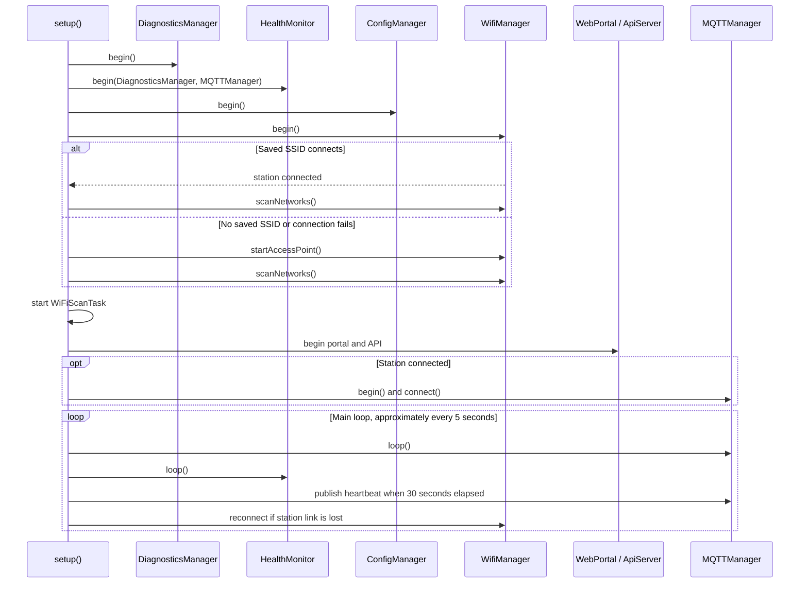
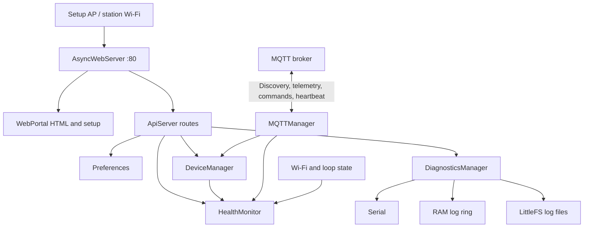

# Firmware Architecture

## Scope

This document describes the firmware represented by the checked-out `v0.3.0-alpha` source. The program is an ESP32 Arduino application built with PlatformIO. It provides Wi-Fi setup and station connectivity, a local async HTTP service, MQTT device messaging, and on-device diagnostics and health monitoring.

## Components

| Component | Responsibility |
|---|---|
| `main.cpp` | Creates manager instances; initializes diagnostics, health, configuration, Wi-Fi, portal, and API; runs MQTT/health service, heartbeat, and Wi-Fi recovery in `loop()`. |
| `WifiManager` | Starts Wi-Fi, connects to saved station credentials, starts the setup AP, and requests reconnection. |
| `ConfigManager` | Reads/writes the `ampercore` ESP32 Preferences namespace for SSID, password, and hub name. |
| `WebPortal` | Owns the `AsyncWebServer` on port 80, HTML portal, Wi-Fi scan coordination, and `/save`/`/scan` routes. |
| `ApiServer` | Registers the `/api/...` handlers on the same server. |
| `MQTTManager` | Connects PubSubClient to its compiled-in broker, subscribes to discovery/device topics, parses inbound messages, publishes commands, and services MQTT. |
| `DeviceManager` | Keeps discovered devices and current telemetry in an in-memory vector; notifies diagnostics and health monitoring. |
| `DiagnosticsManager` | Fans diagnostic records to Serial, a fixed-size RAM ring, and LittleFS files; maintains counters and JSON exports. |
| `HealthMonitor` | Samples health signals, tracks per-device telemetry age and events, and exports health state. |
| `AlertManager`, `EnergyManager` | Headers are present, but no implementation source behavior is currently provided. |

## Startup and Runtime

Diagnostics begin before other managers so that startup and service events use the same logging sink. The health monitor starts before the Wi-Fi and MQTT connection attempts and derives health from observed state as the system runs.

The Wi-Fi scan task is pinned to core 1, checks requests every 250 ms, and scans periodically every 30 seconds while AP mode is active. The actual scan is performed only after a manual request or when the AP-mode interval is due.

## Data Flow

Device inventory, telemetry, health event history, and the diagnostics RAM ring are runtime state. Wi-Fi credentials and hub name are stored in Preferences. Diagnostics logs are appended on LittleFS when initialization succeeds.

## Network and Concurrency

- HTTP uses `ESPAsyncWebServer` and `AsyncTCP` on port 80.
- MQTT uses PubSubClient over a `WiFiClient` TCP connection.
- FreeRTOS is used for the Wi-Fi scan task and manager mutexes.
- API callbacks execute outside the main Arduino loop task; `HealthMonitor` protects its report/event state with a mutex.
- No HTTP authentication/TLS or MQTT TLS/credentials are configured in the current source.

## Configuration and Limits

- PlatformIO environment: `esp32dev`, `espressif32`, Arduino framework, LittleFS.
- HTTP ports, MQTT broker/topic strings, setup AP credentials, and several health thresholds are compiled into source.
- The device registry is RAM-only; no persistence or automatic rediscovery restoration is implemented.
- `AlertManager` and `EnergyManager` do not yet provide source implementations.
- The API device metadata response reports fixed core/flash values rather than probing the actual board.
